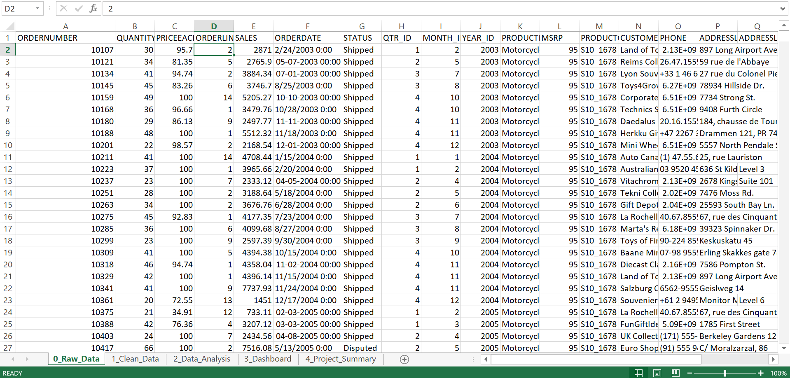
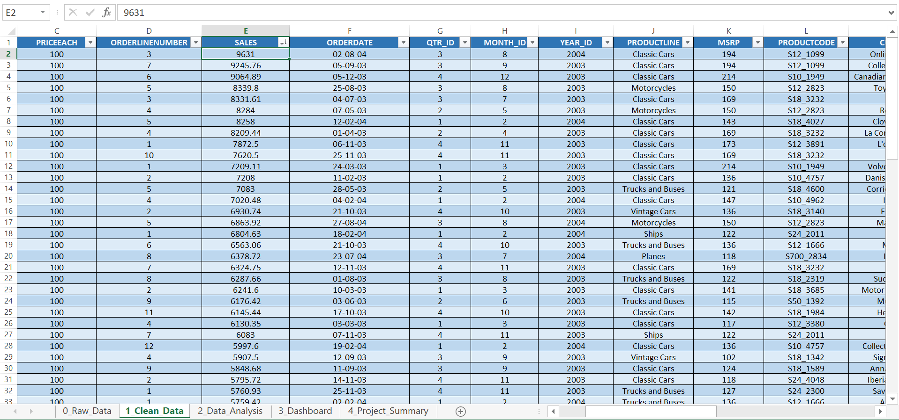
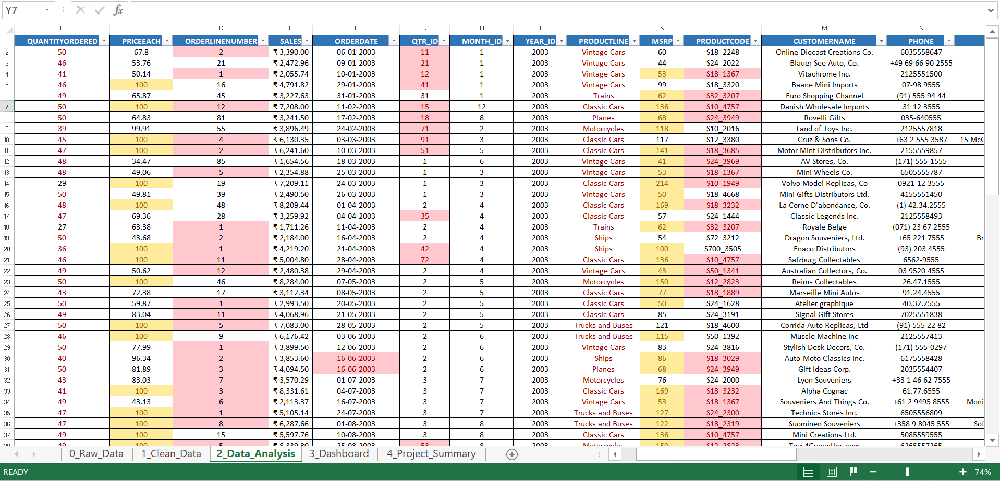
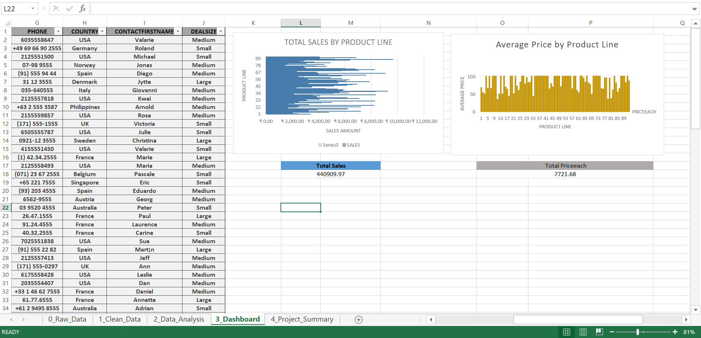
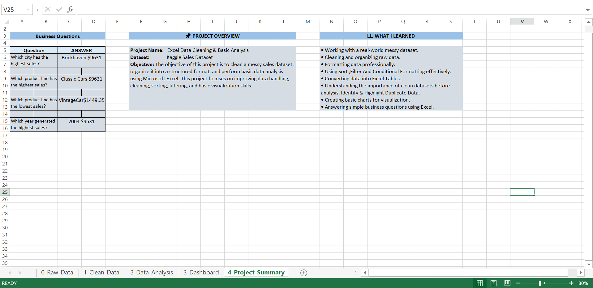

# 🧹 Excel Data Cleaning & Analysis Project

## 📌 Project Overview

This project demonstrates the practical use of Microsoft Excel to clean, prepare, analyze, and visualize a dataset for meaningful business insights.

The project follows a structured data analytics workflow, beginning with raw data and progressing through data cleaning, analysis, visualization, and dashboard development.

---

## 🎯 Project Objective

The primary objective of this project is to transform raw and inconsistent data into a clean, structured, and analysis-ready dataset using Microsoft Excel.

The project focuses on:

- Identifying data quality issues
- Cleaning and standardizing raw data
- Applying Excel functions and formulas
- Performing data analysis
- Creating meaningful visualizations
- Developing an interactive dashboard
- Extracting useful business insights

---

## 🛠️ Tools & Techniques Used

**Tool:** Microsoft Excel

### Excel Techniques

- Data Cleaning & Preparation
- Data Formatting
- Excel Functions & Formulas
- Lookup Functions
- Data Validation
- Conditional Formatting
- Duplicate Detection
- Data Standardization
- Data Analysis
- Pivot Tables
- Charts & Visualizations
- Dashboard Development
- Business Insights

---

## 🔄 Project Workflow

**Raw Data → Data Cleaning → Data Analysis → Visualization → Dashboard → Insights**

### 1. Raw Data

The project begins with the original dataset containing raw data that requires preparation before analysis.

### 2. Data Cleaning

The raw dataset is cleaned and standardized by identifying inconsistencies, formatting issues, duplicates, and other data-quality problems.

### 3. Data Analysis

The cleaned dataset is analyzed using Excel functions, formulas, and analytical techniques to identify relevant patterns and information.

### 4. Dashboard Development

The analyzed data is transformed into a clear and informative dashboard to communicate important findings visually.

### 5. Project Summary & Insights

The final stage summarizes the key findings and outcomes obtained from the analysis.

---

## 📊 Key Learning Outcomes

Through this project, I developed practical experience in:

- Working with raw datasets
- Identifying and resolving data-quality issues
- Preparing analysis-ready data
- Applying Excel formulas and functions
- Performing structured data analysis
- Creating data visualizations
- Designing dashboards
- Communicating analytical findings
- Developing business-oriented insights

---

## 📂 Project Files

- 📷 [Raw Data](01_Raw_Data.png)
- 📷 [Cleaned Data](02_Cleaned_Data.png)
- 📊 [Data Analysis](03_Data_Analysis.png)
- 📈 [Dashboard](04_Dashboard.png)
- 📋 [Project Summary](05_Project_Summary.png)
- 📗 [Excel Project File](Excel_DataCleaning_Project.xlsx)

---

## 💡 Outcome

The project demonstrates how Excel can be used to transform raw data into a structured and analysis-ready dataset and then convert the results into meaningful visualizations, dashboards, and business insights.

---

## 🎓 Skills Demonstrated

**Data Cleaning | Data Analysis | Excel | Data Visualization | Dashboard Development | Business Insights**

---

### 📌 Project Category

**Data Analytics — Excel**

**Focus Area:** Data Cleaning & Analysis
