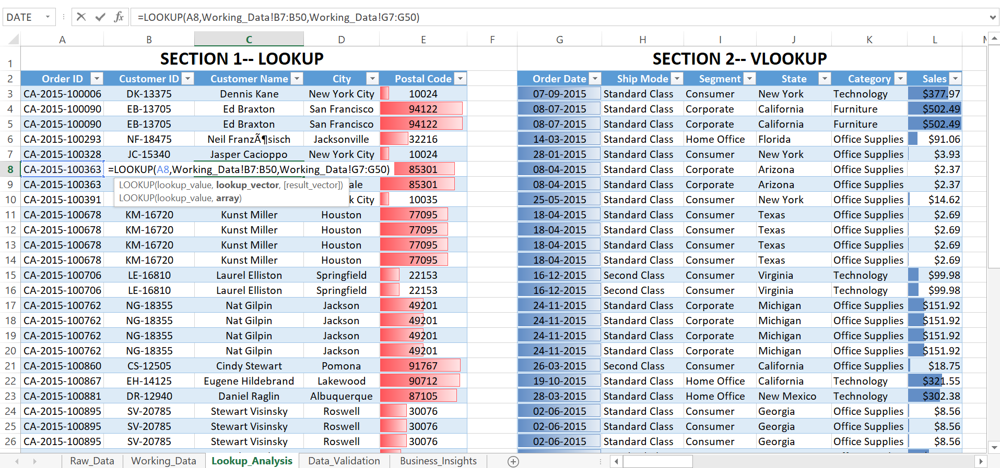
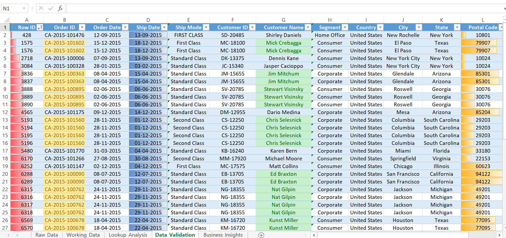

# 🔎 Excel Lookup & Data Validation Project

## 📌 Project Overview

This project demonstrates the practical application of Microsoft Excel lookup functions and data validation techniques for efficient data retrieval, controlled data entry, and improved data accuracy.

The project combines lookup-based information retrieval with data validation to demonstrate how Excel can be used to manage, verify, and analyze structured data effectively.

---

## 🎯 Project Objective

The main objective of this project is to apply Excel lookup and data validation techniques to practical data-related tasks.

The project focuses on:

- Retrieving relevant information from structured datasets
- Applying different lookup functions
- Understanding lookup-based data retrieval
- Creating controlled data-entry fields
- Improving data accuracy and consistency
- Reducing manual data-entry errors
- Generating meaningful business insights

---

## 🛠️ Tools & Techniques Used

**Tool:** Microsoft Excel

### Lookup Functions
- VLOOKUP
- HLOOKUP
- XLOOKUP
- Lookup-based Data Retrieval

### Data Validation
- Data Validation Rules
- Drop-down Lists
- Input Restrictions
- Error Alerts
- Data Consistency Checks

### Supporting Skills
- Excel Functions & Formulas
- Data Formatting
- Conditional Formatting
- Data Analysis
- Business Insight Generation

---

## 🔄 Project Workflow

**Dataset → Lookup Operations → Data Validation → Verification → Analysis → Business Insights**

### 1. Lookup Analysis

Lookup functions are applied to retrieve relevant information from structured datasets based on specified criteria.

The project demonstrates different lookup approaches using VLOOKUP, HLOOKUP, and XLOOKUP.

### 2. Data Validation

Data Validation is used to control data entry and improve consistency.

Drop-down lists and validation rules help restrict inappropriate entries and maintain better data quality.

### 3. Business Insights

The retrieved and validated information is used to support analysis and derive meaningful business insights from the data.

---

## 🔍 Lookup Functions Demonstrated

### VLOOKUP

Used to search for a value vertically within a table and return a corresponding value from another column.

### HLOOKUP

Used to search for a value horizontally within a table and return a corresponding value from another row.

### XLOOKUP

Used for flexible lookup operations and provides greater flexibility than traditional lookup functions in many common scenarios.

---

## 📊 Data Validation Techniques

The project demonstrates how Data Validation can be used to:

- Create controlled input fields
- Build drop-down lists
- Restrict invalid entries
- Improve data consistency
- Reduce manual data-entry errors
- Maintain better data quality

---

## 💡 Business Insights

The project demonstrates how properly retrieved and validated data can be used to support business-oriented analysis and generate useful insights.

The final analysis and business insights are documented within the project workbook and supporting project materials.

---

## 📂 Project Files

- 📷 [Lookup Analysis I](01_Lookup_I.png)
- 📷 [Lookup Analysis II](02_Lookup_II.png)
- 📷 [Data Validation](03_Data_Validation.png)
- 📷 [Business Insights](04_Business_Insights.png)
- 📗 [Excel Lookup & Data Validation Project](Excel_Lookup_Data_Validation_Project.xlsx)

---

## 🎓 Key Learning Outcomes

Through this project, I developed practical experience in:

- Applying VLOOKUP, HLOOKUP, and XLOOKUP
- Selecting appropriate lookup techniques
- Retrieving data efficiently
- Creating data validation rules
- Building controlled drop-down lists
- Improving data-entry accuracy
- Verifying retrieved information
- Connecting Excel techniques with business analysis
- Communicating analytical findings

---

## 📈 Skills Demonstrated

**Microsoft Excel | VLOOKUP | HLOOKUP | XLOOKUP | Data Validation | Data Retrieval | Data Analysis | Business Insights**

---

### 📌 Project Category

**Data Analytics — Excel**

**Focus Area:** Lookup Functions, Data Validation & Business Insights
